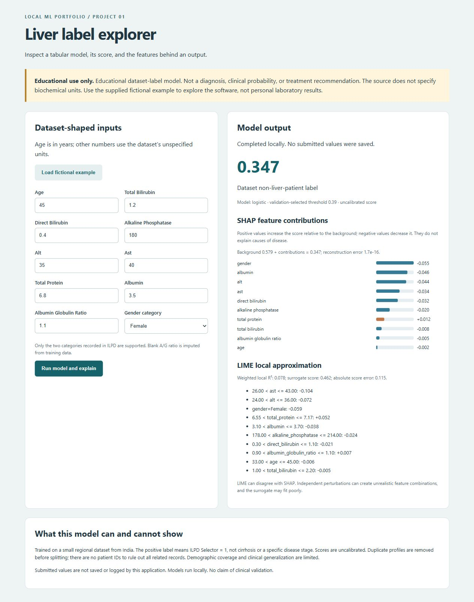

# Explainable liver label classification

An educational, local application that predicts the **ILPD dataset label**, compares three models, and explains the selected pipeline with SHAP and LIME. It does not diagnose liver disease or cirrhosis. Built with AI assistance; the accompanying exercises and interview guide are intended to help the owner understand and maintain it.



## Quick start

Python 3.12 was tested on Windows with CPU only. Python 3.11–3.12 is recommended. From this directory:

```powershell
python -m venv .venv
.venv/Scripts/python.exe -m pip install -r requirements.txt
.venv/Scripts/python.exe download_data.py
.venv/Scripts/python.exe train.py
.venv/Scripts/python.exe -m pytest tests -q -p no:cacheprovider
.venv/Scripts/python.exe app.py
```

Open http://127.0.0.1:5051, load the fictional example, and click **Run model and explain**. After installation/training, `./start.ps1` is the Windows startup shortcut. On Linux/macOS use `.venv/bin/python` in the commands above. No database or cloud account is required. Runtime does not contact external inference services. Downloading the data and installing libraries require internet access.

The local workspace already contains trained artifacts. They are excluded from Git so cloning requires training. Only load joblib artifacts you created or trust: pickle-based deserialization can execute code. Full installed versions are recorded in `artifacts/environment-lock.txt`; `requirements.txt` pins direct dependencies.

## Data source and target

[UCI ILPD](https://archive.ics.uci.edu/dataset/225/ilpd+indian+liver+patient+dataset), DOI [10.24432/C5D02C](https://doi.org/10.24432/C5D02C), attributed to B. Ramana and N. Venkateswarlu. UCI states **CC BY 4.0**. The download script reads the official archive and saves its SHA-256, CSV hash and original member name in `artifacts/data_provenance.json`; later downloads reject a changed CSV. The full source data is not committed, although the license permits attributed reuse. Aggregate evaluation and source row indices are included.

Selector 1 is encoded as positive (liver patient), Selector 2 as negative. These labels do not establish a particular disease, severity, future outcome, or cirrhosis. Collection is regional, from northeast Andhra Pradesh, India; detailed sampling and diagnostic criteria are not supplied in the repository metadata. The source page contains inconsistent counts and missingness claims: the downloaded file actually has **583 rows, 416 positive labels, 167 negative labels, 13 exact duplicates and four missing A/G ratios**. After feature-profile deduplication there are 570 records. No conflicting labels for identical profiles were found.

| API field | Meaning in UCI |
|---|---|
| age | Age in years; values above 89 top-coded as 90 |
| gender | Female/Male categories supplied by the dataset |
| total_bilirubin / direct_bilirubin | Total/direct bilirubin |
| alkaline_phosphatase | Alkaline phosphatase |
| alt / ast | Alanine/aspartate aminotransferase (source uses SGPT/SGOT) |
| total_protein / albumin | Total proteins/albumin |
| albumin_globulin_ratio | Albumin-to-globulin ratio; null is supported |

**Biochemical units are not specified by UCI.** The software does not infer them. Inputs are dataset-shaped examples, not a way to interpret personal lab results. Three source records have direct bilirubin above total bilirubin; they are flagged in the audit and retained rather than silently corrected. The API rejects that inconsistency for new input. This is a documented training-versus-entry discrepancy and data-quality limitation.

## Architecture and experiment

`official CSV → profile deduplication → stratified train/validation/test → fitted pipeline → saved artifacts → Flask validation → score → pipeline-level SHAP/LIME → browser`

The fixed seed is 42. Splits contain 342/114/114 rows, with 244/81/81 positive labels. Exact feature profiles cannot cross splits; no patient IDs are available to rule out related but nonidentical records. The label is excluded from all input features. Training-only numeric summaries and correlations are saved in `data_audit.json`. Highly related biochemical measurements are retained and make attribution less straightforward.

Each scikit-learn pipeline median-imputes numeric values, standardizes them, and encodes gender as one binary column. All fitted transforms see training data only. The candidates are a prior dummy, balanced logistic regression (C=1), and a balanced 250-tree Random Forest (depth 6, minimum leaf 5). Class weights address imbalance without oversampling or changing test prevalence. Scaling is unnecessary for the forest but keeps a common feature contract. CPU-only, one forest worker.

For learned models, a 0.10–0.90 threshold grid selects validation macro-F1, breaking ties toward 0.5. The dummy stays at 0.5. Model selection includes the dummy and uses validation macro-F1, then average precision. No retraining or threshold adjustment occurs after looking at test scores. Hyperparameters were fixed beforehand; the small validation set can still make selection unstable.

## Actual evaluation

| Model | Test macro-F1 | Positive precision | Positive recall | ROC-AUC | Average precision | Threshold |
|---|---:|---:|---:|---:|---:|---:|
| dummy | 0.415 | 0.711 | 1.000 | 0.500 | 0.711 | 0.50 |
| logistic | 0.595 | 0.769 | 0.741 | 0.722 | 0.891 | 0.39 |
| forest | 0.656 | 0.867 | 0.642 | 0.761 | 0.890 | 0.54 |

Validation selected **logistic**, threshold **0.39**. All scores above use the same 114 held-out records. Precision/recall/F1 for both classes and confusion matrices are in `artifacts/metrics.json`; ROC and PR curves are in `artifacts/test_curves.png`. Average precision is reported separately from trapezoidal PR-AUC. Positive prevalence is 81/114 = 0.711, so a seemingly high AP must be compared with that prior baseline. The selected logistic model's confusion matrix is [[15,18],[21,60]] (rows true 0/1, columns predicted 0/1). Its low negative-class recall is a material limitation, not hidden by accuracy.

The score is **uncalibrated**, especially with class weighting. Brier scores are descriptive, not evidence of clinical calibration. Results at threshold 0.5 are also saved. This single small split has high uncertainty; it is not external validation. Do not choose a new model based on this test table and then claim the same test set remained untouched.

## Explanations

SHAP uses a permutation explainer around the entire fitted pipeline, in the original ten-feature space. Forty seed-selected training rows form its background; 231 evaluations approximate the feature allocations. The code verifies `base + contributions = actual score` within 1e-6. This numerical check does not prove explanation correctness or causality. Correlation and background choice matter.

LIME uses training-derived discretization and 2,000 seeded perturbations. Gender remains categorical, and its prediction callback runs the same pipeline. Its prediction on the original input must equal the actual score. The UI reports local weighted R², surrogate score and absolute score error. Contributions are to the surrogate, not exact SHAP equivalents. Numeric perturbations can create implausible combinations. Missing A/G ratio is filled with the same training median and explicitly flagged before explaining.

## API

- `GET /api/health`: 200 when artifacts load; 503 with recovery instructions otherwise.
- `POST /api/predict`: JSON with exactly ten fields. Returns score, label, threshold, warnings, SHAP and LIME. Unknown keys, invalid category, nonfinite numbers, inconsistent measurements and invalid ages return 400. Wrong content type returns 415, oversized bodies 413, unsupported methods 405. Inference failures return a generic 500 without echoing values.

```powershell
Invoke-RestMethod http://127.0.0.1:5051/api/health
Invoke-RestMethod http://127.0.0.1:5051/api/predict -Method Post -ContentType application/json -Body (Get-Content examples/fictional_input.json -Raw)
```

```bash
curl -H 'Content-Type: application/json' --data-binary @examples/fictional_input.json http://127.0.0.1:5051/api/predict
```

The example is fictional, not a copied patient's record. See `artifacts/example_response.json` for a verified output. No submissions are persisted or logged. Cache-Control is no-store, scripts are local, and the server binds to loopback through Waitress. It has no authentication, clinical safeguards, or public-deployment hardening. The single worker avoids concurrent explainer RNG interactions; this is not a throughput-oriented service.

## Evidence and learning

- [Model card](MODEL_CARD.md)
- [Five-minute demonstration](DEMO.md)
- [Twenty interview questions and exercises](INTERVIEW_GUIDE.md)
- [Resume claims and evidence](EVIDENCE.md)
- [Status and commands run](STATUS.md)

Tests cover validation, pipeline/raw-coordinate equivalence, training-only imputation, duplicate-free splits, explanation reconstruction, HTTP failure paths and independent rescoring. Third-party deprecation warnings are reported in the test log. No production users, clinical impact, deployment, or independently authored achievement is claimed.

Primary implementation references: [scikit-learn evaluation](https://scikit-learn.org/stable/modules/model_evaluation.html), [SHAP API](https://shap.readthedocs.io/en/latest/api.html), [LIME API](https://lime-ml.readthedocs.io/en/latest/lime.html), [Flask](https://flask.palletsprojects.com/en/stable/).
