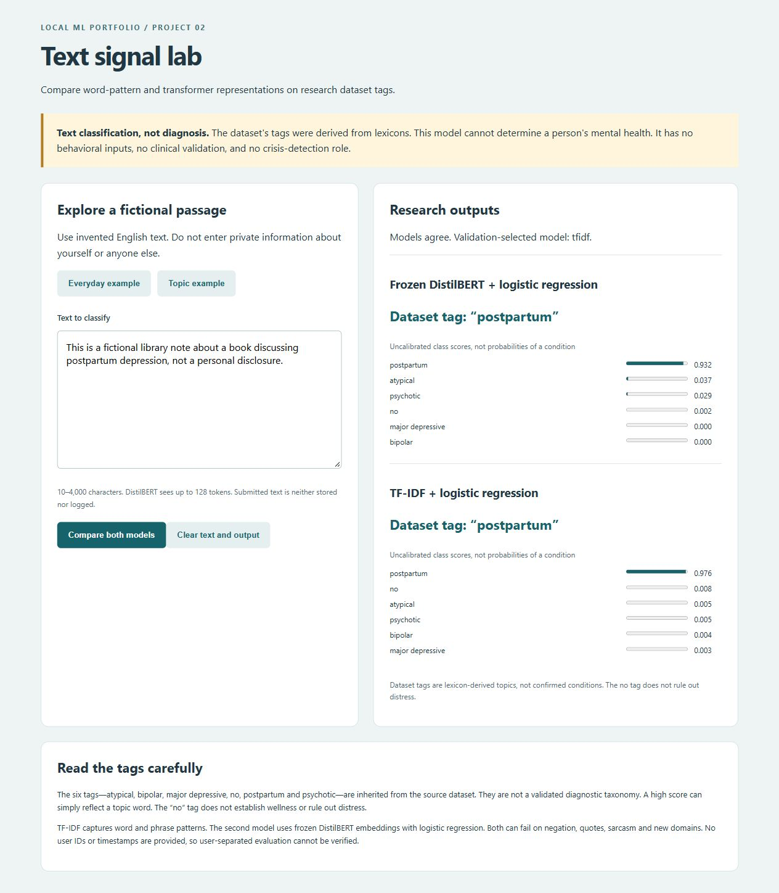

# Text-only depression-related label classification

A local research prototype comparing TF-IDF and frozen DistilBERT representations. It predicts **lexicon-derived dataset tags**, not whether a person has depression. There are no behavioral features and this is not a multimodal system. Built with AI assistance as a learning portfolio project.



## Setup and demo

Python 3.12, CPU-only Windows is the tested environment. From this project directory:

```powershell
python -m venv .venv
.venv/Scripts/python.exe -m pip install -r requirements.txt
.venv/Scripts/python.exe download.py
.venv/Scripts/python.exe train.py
.venv/Scripts/python.exe -m pytest tests -q -p no:cacheprovider
.venv/Scripts/python.exe app.py
```

Open http://127.0.0.1:5052. Choose one of the **fictional** examples and compare both models. On Windows `./start.ps1` starts an already-trained installation; on Linux/macOS substitute `.venv/bin/python`. Downloads are free and require internet; inference runs locally with `local_files_only=True`. Model weights, private input, dataset text and trained pickle files are not committed. Train after cloning. Never load untrusted joblib artifacts.

## Source, permission and labels

[Muhammad Osama Nusrat's Zenodo release](https://zenodo.org/records/14233292), version v1.0, DOI 10.5281/zenodo.14233292, explicitly states CC BY 4.0 permission. [The accompanying paper](https://arxiv.org/abs/2404.13104) describes lexicon-based collection and annotation. We download the creator's release, not scrape user accounts. Attribution and SHA-256 are in `artifacts/provenance.json`. The pinned CSV is rejected if its hash changes.

The actual CSV has 14,996 rows and only `Tweets` and `Labels`. Tags and original counts: postpartum 3,747; major depressive 2,517; bipolar 2,443; psychotic 2,312; no 1,985; atypical 1,980. These are inherited dataset names, not a validated diagnostic taxonomy. In particular, topic labels must not be used to infer a clinical condition. “No” is simply one dataset category, not reassurance about health.

There are **no user IDs, timestamps or behavioral columns**. The project therefore cannot perform user-level splits or behavior-only/fusion experiments. It makes no claims about posting frequency, sleep patterns, multimodal signals or user diagnosis. The publisher's usage permission does not establish individual clinical consent or validate labels. Text may remain sensitive even when direct identifiers are absent; raw text is kept out of published outputs and demonstrations.

## Pipeline and leakage controls

`creator CSV → normalization/redaction → conflicting-label and exact-duplicate removal → seeded stratified 3,000-row subset → 60/20/20 splits → representation comparison → validation selection → held-out evaluation → Flask demo`

Normalization applies Unicode NFKC, lowercasing, whitespace collapse and URL/email/handle replacement. It does not invent behavioral measurements. Punctuation-insensitive duplicate keys are removed before splitting; conflicting-label groups are removed entirely. No patient/user-disjoint claim is possible. A training-vocabulary cosine-similarity audit records possible near duplicates rather than pretending exact deduplication removes all related text.

The fixed CPU budget is 3,000 eligible texts, chosen by stratified sampling with seed 42 before modeling. Splits are 1,800 train, 600 validation and 600 test. The full source is not used to claim a larger experiment. All source row indices and counts are saved.

TF-IDF uses training-only unigram/bigram vocabulary, minimum document frequency 2, at most 15,000 features and sublinear term frequency. Its classifier is class-balanced logistic regression. DistilBERT uses the pinned Apache-2.0 `distilbert/distilbert-base-uncased` weights in evaluation mode with gradients disabled. Attention-mask mean pooling (including special tokens) yields 768 features; padding is excluded. Maximum length is 128 tokens, batch size 8, four CPU threads. Training-only StandardScaler and balanced logistic regression are fitted to embeddings. No transformer fine-tuning is claimed.

For each representation, C is selected from 0.1, 1 and 10 by validation macro-F1, preferring the smaller C on ties. A most-frequent dummy is included in model selection. Decisions use argmax, with no clinical threshold. Test labels do not select hyperparameters or the served-model recommendation. Embeddings are cached using a fingerprint of splits, revision and preprocessing settings. Re-running can reuse the cache; delete only the known local `artifacts/embeddings.npz` to force extraction.

## Measured results

| Model | Validation macro-F1 | Test macro-F1 | Test with label terms masked |
|---|---:|---:|---:|
| tfidf | 0.913 | 0.900 | 0.661 |
| distilbert | 0.830 | 0.832 | 0.612 |
| dummy | 0.067 | 0.067 | N/A |

Validation selected **tfidf**. All test results use the same 600 records. Per-class precision, recall, F1 and confusion matrices are in `artifacts/metrics.json`; `confusion_matrices.png` visualizes errors. Predictions include source row index, labels and scores, but **no source text**.

Audit found 0 conflicting duplicate groups and removed 76 same-label duplicates; 14906 unique eligible rows remained before the CPU subset. The near-duplicate audit found 2 test rows with training cosine similarity ≥0.90. Exact counts, per-split class balance and explicit-label-term frequency are saved in `data_audit.json`.

The masked diagnostic removes explicit category/depression terms only after model selection. It tests keyword dependence and introduces distribution shift; it does not eliminate the creator's entire labeling lexicon or prove a causal effect. Do not present its result as a new tuned benchmark. Topic leakage and weak labels can make ordinary scores misleadingly strong. Quoted educational content can receive a condition-named tag despite not describing anyone's health.

## API and privacy

- `GET /api/health`: ready (200) or unavailable (503).
- `POST /api/predict`: exactly `{"text":"fictional English passage"}`, 10–4,000 characters and at least three alphabetic words. Returns both models' six class scores, dataset tags, disagreement indicator and truncation warning.
- Invalid fields/content return 400; non-JSON 415; oversized bodies 413; missing model files 503. Generic inference errors do not echo text.

```powershell
Invoke-RestMethod http://127.0.0.1:5052/api/predict -Method Post -ContentType application/json -Body (Get-Content examples/fictional_input.json -Raw)
```

Scores are uncalibrated and not probabilities of mental-health conditions. Both models must choose a known tag even for unrelated input; disagreement or a low maximum score is not a validated abstention policy. DistilBERT can truncate; TF-IDF uses all normalized input. The app does not persist, echo, or log submitted text. Clear removes text/output from the page. No external inference API, analytics or input-history feature is used. Loopback-only Waitress, one worker, no-store responses. This is not hardened for public hosting.

## Limitations and learning

English-only source, lexicon/corpus selection bias, class imbalance, missing user independence, potential semantic duplicates, domain shift, sarcasm and negation errors. Source preprocessing may have removed information irreversibly. Pretraining can overlap public internet material. No clinical screening, severity inference, crisis detection or treatment advice is provided.

See [MODEL_CARD.md](MODEL_CARD.md), [DEMO.md](DEMO.md), [INTERVIEW_GUIDE.md](INTERVIEW_GUIDE.md), [EVIDENCE.md](EVIDENCE.md) and [STATUS.md](STATUS.md). The implementation favors a reproducible CPU study over unsupported claims of diagnostic accuracy.
