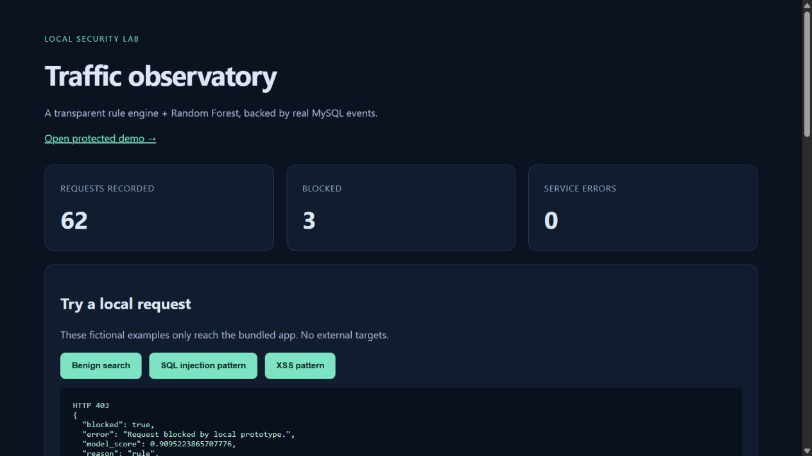

# Local WAF · Traffic observatory

A working localhost reverse proxy with transparent SQLi/XSS rules, a Random Forest detector, a protected Flask app and real MySQL event storage. This is an educational defensive prototype, not production protection.



## Run on Windows

Python 3.12, internet for initial dependencies and the official MySQL download, and roughly 2 GB free disk are needed. MySQL's Microsoft Visual C++ runtime must be installed. No GPU, Docker, cloud account or paid API is required.

```powershell
cd 03_local_waf
py -3.12 -m venv .venv
.\.venv\Scripts\python.exe -m pip install -r requirements.txt
.\.venv\Scripts\python.exe train.py
.\.venv\Scripts\python.exe setup_mysql.py
.\start.ps1
```

Open http://127.0.0.1:5053. Keep the terminal open; Ctrl+C stops owned services. If PowerShell blocks scripts, run `.\.venv\Scripts\python.exe run_local.py` instead. On the delivered workstation the environment, trained model and database are already prepared. After cloning, run the setup commands above; binaries, virtual environments and credentials are intentionally excluded from Git.

Ports: gateway 5053, bundled backend 5091, MySQL 3307, all bound to 127.0.0.1. Free occupied ports before starting; do not launch multiple copies. The launcher checks model artifacts and service readiness. Local runtime logs assist startup troubleshooting. Do not expose any of these ports publicly.

## Architecture and behavior

Browser → gateway → normalize bounded input → rule/forest decision → insert redacted MySQL event → block or forward to the fixed bundled backend → record status and duration. The dashboard polls the latest 30 events every five seconds. The backend uses parameterized SQL and Jinja escaping independently of the WAF. Flask-WTF verifies session CSRF tokens on note submissions; the ML detector does not provide CSRF protection.

Only `/app/`, `/app/search` and `/app/note` can be proxied. Arbitrary target URLs, arbitrary upstream paths, file uploads and public clients are unsupported. Bodies are limited to 8192 bytes. Search and notes have 200-character limits. Requests fail closed if the initial event insert fails; if the final update fails after forwarding, `X-Event-Completion: unavailable` signals an incomplete event. The completed upstream action cannot be undone.

## Data and measured evaluation

All 930 payloads are authored synthetic strings in `train.py`. There are 330 training, 240 validation and 360 test rows, with disjoint named template families. URL-encoded variants stay within the same split. Seed 42; 200 trees, depth 8, minimum leaf size 3, balanced classes. Validation macro-F1 selects RF threshold 0.5. Feature extraction is shared by training and serving; features include punctuation, length, keyword counts and digit ratio.

| Test method | Macro-F1 | False positives / 180 benign | False negatives / 180 attacks |
|---|---:|---:|---:|
| Rules | 0.8333 | 30 | 30 |
| Random Forest | 0.9161 | 30 | 0 |
| Rules OR forest (served) | 0.8286 | 60 | 0 |

The combined system is more aggressive and performs worse by macro-F1 than either component. Benign HTML tutorials trigger rules; other benign formats trigger the model. These tradeoffs are retained, not hidden by selecting a favorable test threshold. Synthetic pattern overlap with feature design makes the scores optimistic. Zero observed false negatives is not evidence of comprehensive attack protection. See [full reports](artifacts/metrics.json), [row-level test decisions](artifacts/test_predictions.csv), and [model card](MODEL_CARD.md).

## API and verification

`GET /api/health` reports MySQL readiness. `GET /api/events` returns summary counts and redacted events. `GET /app/search?q=notebook` returns a product. A blocked request returns 403 with rule hits, model score and a request ID. `POST /app/note` takes a URL-encoded `note` plus `csrf_token` and the session cookie obtained from `GET /app/`. Invalid tokens return 400; unsupported media return 415; oversized bodies return 413; unavailable database returns 503; unavailable upstream returns 502.

With the stack running, use another terminal:

```powershell
.\.venv\Scripts\python.exe -m pytest tests -q -p no:cacheprovider
.\.venv\Scripts\python.exe benchmark.py
.\.venv\Scripts\python.exe -m pip check
```

10 tests passed on 2026-11-03, including live MySQL and independent backend defenses. [Test output](artifacts/test_run.txt). For offline unit tests use `-m "not integration"`. [Latency measurements](artifacts/latency.json) contain 50 sequential requests per endpoint after five warmups, measured on this Windows CPU machine. They include client/network/database overhead and do not represent production load capacity.

## Privacy and limits

Security events omit complete payloads, query values, cookies, authorization and CSRF token values. Only fixed routes, decision metadata, timing and body size are retained. Fictional demo notes are deliberately persisted separately in the local notes table. Do not enter private data. No remote telemetry is implemented.

Generated database credentials and the session secret live only in ignored `runtime/config.json`. MySQL is a portable official Windows build, not a system service. The bootstrap SQL is removed after startup. The app database account is scoped to this database, but shares tables across the demo and gateway; production needs stronger separation. No TLS termination, authentication, rate limiting, log rotation, anomaly monitoring, adversarial validation or distributed deployment is implemented. Headers/cookies are not inspected for attacks. Double decoding is bounded, and parser differentials can bypass rules.

## References and walkthrough

- [Official MySQL download](https://dev.mysql.com/downloads/mysql/8.4.html); version and hash in [provenance](artifacts/mysql_provenance.json). MySQL GPLv2 binaries are downloaded separately, not redistributed here.
- [Flask-WTF CSRF](https://flask-wtf.readthedocs.io/en/1.2.x/csrf/)
- [OWASP parameterized queries](https://cheatsheetseries.owasp.org/cheatsheets/SQL_Injection_Prevention_Cheat_Sheet.html)
- [OWASP logging guidance](https://cheatsheetseries.owasp.org/cheatsheets/Logging_Cheat_Sheet.html)
- [Five-minute demo](DEMO.md), [interview practice](INTERVIEW_GUIDE.md), [evidence-backed resume bullets](EVIDENCE.md), [completion status](STATUS.md).
